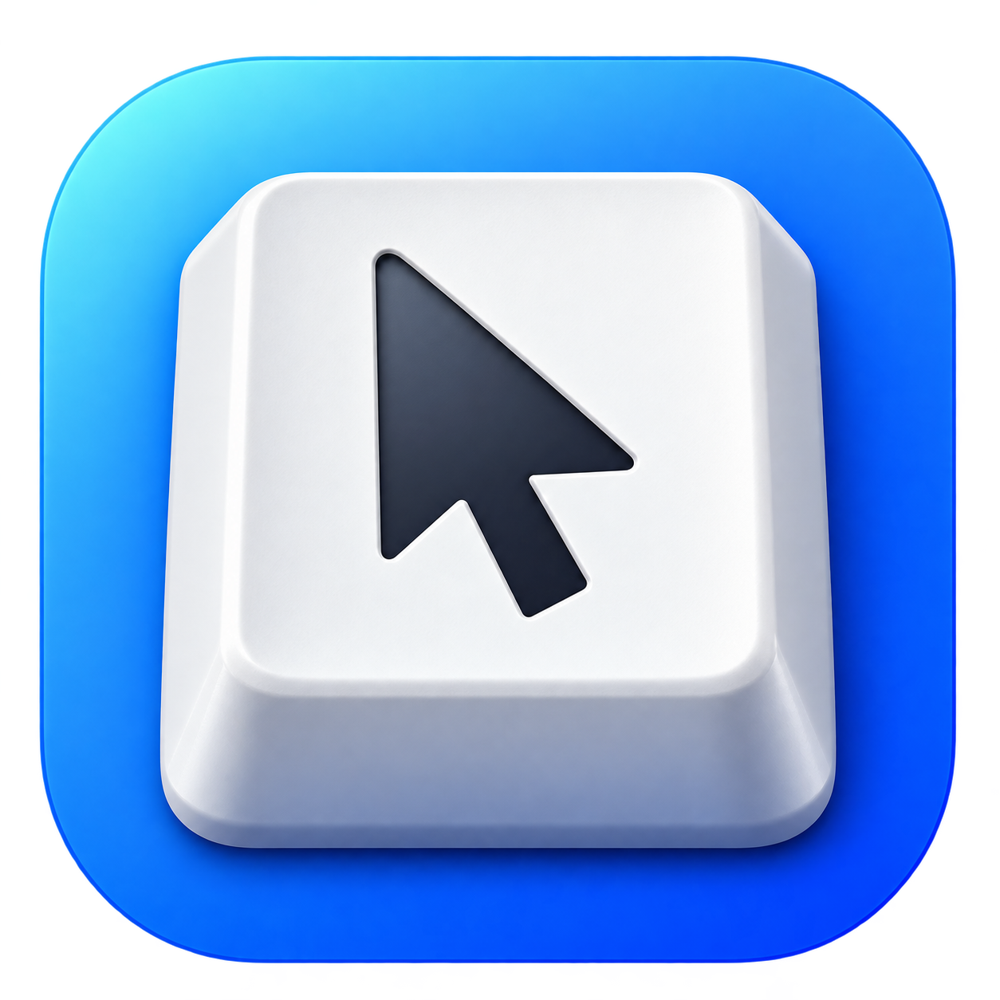

<p align="center">
  <a href="https://amanpalariya.github.io/keymouse/">
    
  </a>
</p>

<h1 align="center">KeyMouse</h1>

<p align="center">
  Control the macOS pointer with your keyboard.<br>
  Move, click, drag, and scroll.
</p>

<p align="center">
  <a href="https://amanpalariya.github.io/keymouse/">Visit the website →</a>
</p>

## Install

Requires macOS 14 or later and Xcode Command Line Tools.

```sh
git clone https://github.com/amanpalariya/keymouse.git
cd keymouse
./scripts/install-app.sh
open /Applications/KeyMouse.app
```

Click **Allow Access**, then enable **KeyMouse** in **System Settings → Privacy & Security → Accessibility**. If it is missing, add `/Applications/KeyMouse.app`. If access stops working after a rebuild, remove the old Accessibility entry and add the app again.

## Controls

Tap <kbd>⌥ Option</kbd> to toggle keyboard control. Press <kbd>Esc</kbd> to stop.

| Keys | Action |
| --- | --- |
| <kbd>H</kbd> <kbd>J</kbd> <kbd>K</kbd> <kbd>L</kbd> or arrow keys | Move left, down, up, right |
| <kbd>Space</kbd> or <kbd>W</kbd> | Left click |
| <kbd>E</kbd> | Middle click |
| <kbd>R</kbd> | Right click |
| Hold <kbd>F</kbd> / <kbd>D</kbd> | Fast / slow movement |
| Hold <kbd>Shift</kbd> + movement keys | Scroll |

Hold a click key while moving to drag. Tap twice to double-click.

Change activation and bindings in **Settings → Controls**. <kbd>Space</kbd> always left-clicks. Bindings use physical US keyboard positions. Adjust pointer speed, scrolling, acceleration, and deceleration in **Settings → Motion**.

By default, control stops after 30 seconds of inactivity, on an unbound key, or when you move a physical pointer. Configure these in **Settings → General**. Launch at login is enabled on first launch. KeyMouse runs in the background without a Dock icon. Closing Settings keeps keyboard control running; choose **Quit** in the menu bar to exit. Open Settings from the menu bar, or open KeyMouse again from Applications if the menu bar icon is hidden.

## Development

```sh
./scripts/build-app.sh  # Build dist/KeyMouse.app without installing
swift test             # Requires full Xcode for XCTest
```

Run the app bundle rather than `swift run` so Accessibility permissions belong to the app. Builds use ad-hoc signing by default. Set `SIGNING_IDENTITY` to an installed Apple signing identity for stable permissions across rebuilds. Distribution requires Developer ID signing and notarization.

The build script explicitly links against the selected macOS SDK and verifies the executable's recorded SDK version before packaging. macOS 14 remains the minimum deployment target. The menu bar uses an AppKit popover with explicit status-button toggling, outside-click dismissal, and Escape handling.

The app uses a filtering Core Graphics event tap without App Sandbox. Secure input fields and protected macOS surfaces may prevent keyboard capture.

## Website

Static files live in `docs/`. GitHub Pages publishes that folder from `main`.

```sh
python3 -m http.server 4173 --bind 127.0.0.1 --directory docs
```
